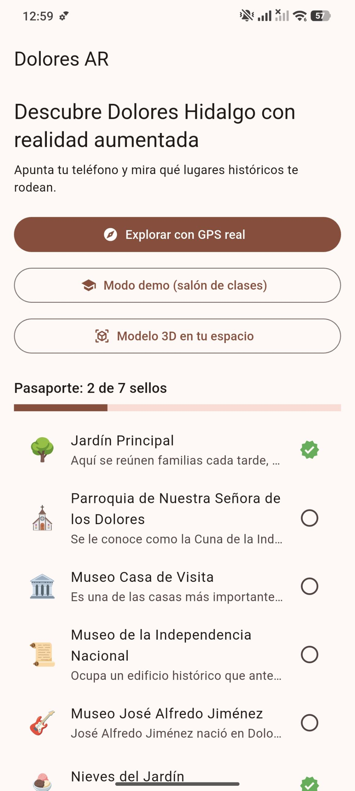
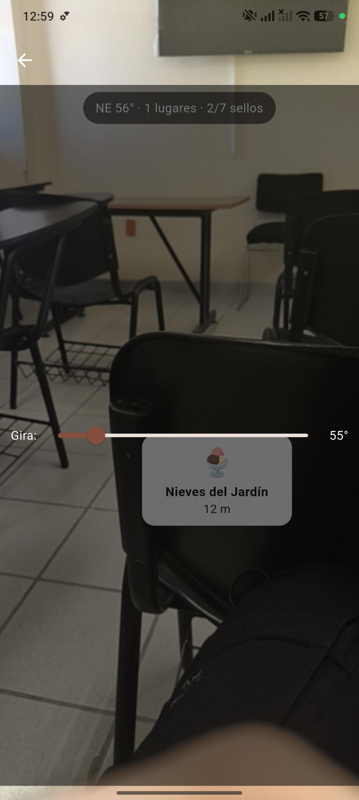
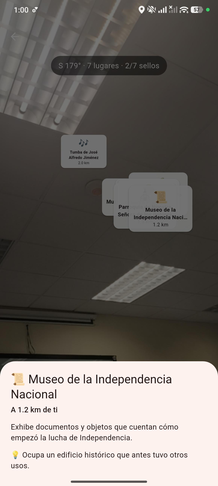

# Dolores AR — realidad aumentada turística con TDD

App turística: apuntas el teléfono en Dolores Hidalgo y sobre la cámara aparecen etiquetas de la Parroquia, los
museos, las nieves… con su distancia. Al acercarte a menos de 40 m ganas el **sello** del pasaporte turístico.
Incluye **modo demo** (para el salón, con un deslizador que simula la brújula) y **modelo 3D en tu espacio**
(ARCore vía `model_viewer_plus`). Construida con **TDD** siguiendo el *Manual paso a paso con TDD — Dolores AR*:
Haversine, rumbo, el salto 359°→1°, campo de visión, filtro de la brújula, motor de RA y fuentes de datos detrás de
contratos para probar sin GPS.

**Retos del manual incluidos:** distancia Parroquia–Jardín, `suavizarAngulo` siempre en 0..360, filtro por categorías,
pasaporte guardado (solo ids, nunca coordenadas).

---

## 📦 APK

| Archivo | Ruta |
|---|---|
| Lista para instalar | `apk/DoloresAR.apk` (18.5 MB) |
| Salida de Flutter | `build/app/outputs/flutter-apk/app-release.apk` |

```bash
flutter build apk --release --target-platform android-arm64
```

El APK es para teléfonos **arm64** (prácticamente todos los Android de los últimos años). Para instalar: copia el `.apk` al teléfono, ábrelo y acepta *instalar apps de origen desconocido*.

Permisos que pide la app (solo al usarlos): **cámara** y **ubicación mientras se usa**. El modelo 3D se descarga
de internet y la RA de superficie requiere un teléfono compatible con ARCore.

---

## 🏗️ Estructura

```text
lib/
├── dominio/        geo (Haversine, rumbo, ángulos, campo de visión) · lugar · catalogo · motor_ar · pasaporte
│                   fuentes (contratos FuentePosicion/FuenteBrujula) · excepciones
├── datos/          fuentes_reales (geolocator + flutter_compass) · fuentes_simuladas (MODO DEMO)
├── presentacion/   ar_viewmodel · fondo_camara · pantalla_ar · pantalla_modelo3d · pantalla_inicio
└── main.dart
test/  ayudas_geo · geo_test · motor_ar_test · pasaporte_test · ar_viewmodel_test
```

---

## 🔴🟢🔵 Evidencia del ciclo TDD

### 1. 🔴 ROJO — las pruebas se escriben primero y fallan

Las pruebas de `test/` se escribieron **antes** que el código. Al correr `flutter test` con `lib/` todavía vacía, nada compila.

### 2. ❌ Error real atrapado por una prueba

`formatearDistancia` del manual decide la unidad con el valor **sin redondear**:

```dart
metros < 1000 ? '${metros.round()} m' : '${(metros / 1000).toStringAsFixed(1)} km';   // ❌
```

Con 999.6 m la condición es verdadera y luego `round()` da **"1000 m"** (debería decir "1.0 km"). Es un error de
frontera como los que el manual enseña a cazar; la prueba de frontera lo atrapó.

**Corrección:** redondear primero y después elegir la unidad:

```dart
final m = metros.round();
return m < 1000 ? '$m m' : '${(metros / 1000).toStringAsFixed(1)} km';   // ✅
```

### 3. 🔵 REFACTOR — limpiar sin romper nada

`flutter analyze` señaló avisos de estilo.

Se corrigieron y se volvió a analizar hasta dejar `flutter analyze` limpio.

### 4. 🟢 VERDE — las 48 pruebas pasan

Las 48 pruebas del proyecto pasan tras completar el ciclo de desarrollo y correcciones.

### 5. 📦 Compilación del APK

El APK de liberación se compila en modo `release` para `android-arm64`.

---

## ✅ Qué cubren las pruebas

| Grupo | Lo que se verifica |
|---|---|
| Distancia | 1° de latitud = 111.2 km, cero, simetría, triángulo 3-4-5, Parroquia–Jardín entre 30 y 120 m |
| Rumbo y ángulos | N/E/S/O/NE, `normalizar360`, camino corto `diferenciaAngular(10, 350) = 20`, suavizado que cruza el norte, nombre cardinal |
| Pantalla | posición horizontal en el campo de visión de 60°, `85 m` / `1.3 km` / frontera 999.6 m |
| Motor RA | centro, fuera de vista, al girar, lado contrario, radio máximo, cruce 0°/360°, orden lejos→cerca, escala, categorías |
| Pasaporte | sello a ≤ 40 m una sola vez, progreso, guardar solo ids |
| ViewModel | espera GPS y brújula, suaviza, sello una vez, errores amables y sin detalles, deja de escuchar al cerrar |

```bash
flutter test
```

---

## 📱 Capturas de la app

> Tomadas en un teléfono físico con el APK instalado. *Guarda tus capturas en `capturas/` con estos nombres y aparecerán aquí automáticamente.*

| Inicio y pasaporte | Modo demo: etiquetas | Detalle de un lugar |
|---|---|---|
|  |  |  |

| ¡Sello conseguido! | Modelo 3D en tu espacio | Error: sin permiso de ubicación |
|---|---|---|
|  |  |  |

### Qué probar en la app

| Caso | Qué hacer | Resultado esperado |
|---|---|---|
| Modo demo | "Modo demo (salón de clases)" y mueve el deslizador | Las etiquetas aparecen y se desplazan |
| Sello | Entra al modo demo | "🏅 ¡Sello conseguido: Jardín Principal!" y ✔ en el inicio |
| GPS real | "Explorar con GPS real" y niega el permiso | Mensaje rojo: "Necesito el permiso de ubicación…" |
| 3D | "Modelo 3D en tu espacio" → ícono AR | Coloca el modelo en el piso (ARCore) |

---

## 🛠️ Cómo correr el proyecto

```bash
flutter pub get
```

```bash
flutter test
```

```bash
flutter run
```
